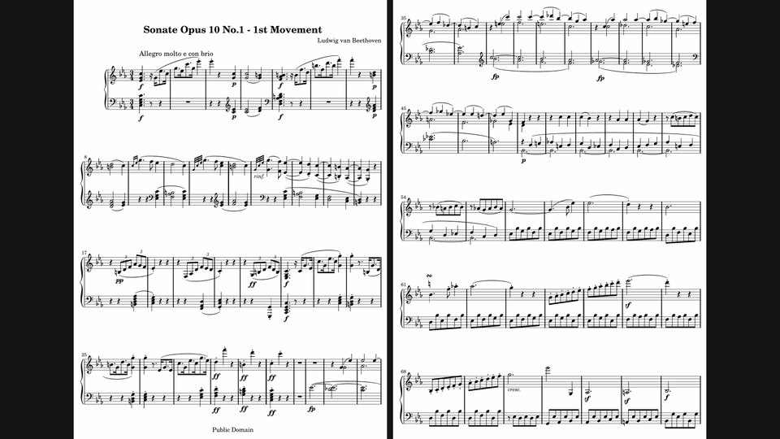
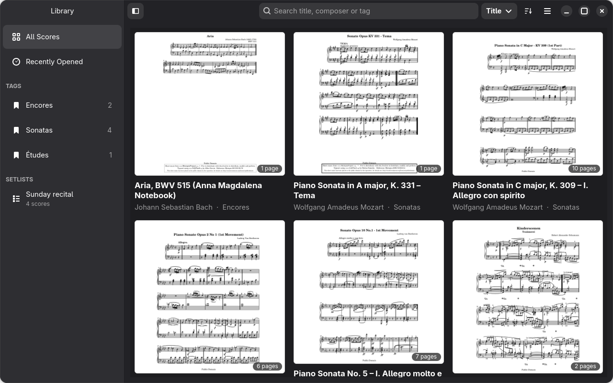
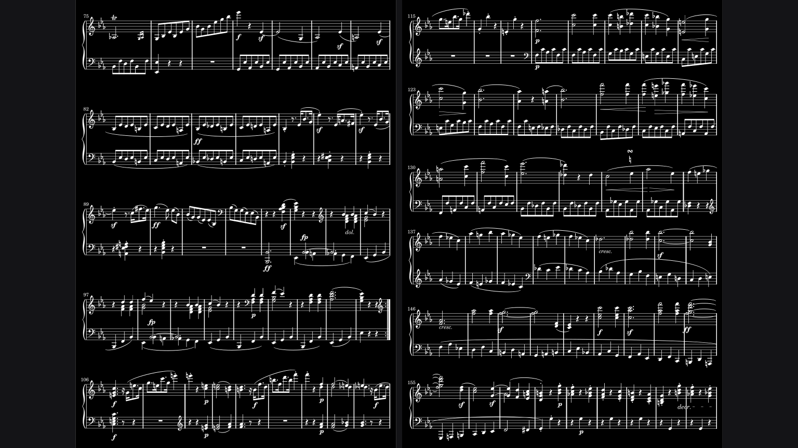
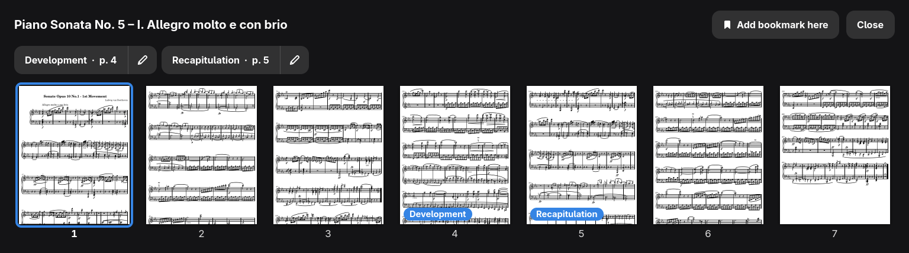

<div align="center">
  
  <h1>Leggio</h1>
  <p>Read sheet music PDFs from a screen on your music stand.</p>
  <p>
    <a href="https://github.com/MrGilfy/leggio/releases/latest"></a>
    <a href="https://github.com/MrGilfy/leggio/actions/workflows/ci.yml"></a>
    <a href="LICENSE"></a>
  </p>
</div>



Leggio keeps a library of your sheet music PDFs, with search, tags and
setlists. Scores open fullscreen with the white margins cut off, and pages
turn instantly by tap, swipe, keyboard or Bluetooth pedal. You can draw on
a score, jump to a D.S. or coda with one tap, bookmark long scores and
export them as PDFs, and your PDF files are never changed.

<p align="center">
  
  
</p>
<p align="center">
  
</p>

## Install

**Arch Linux.** From the AUR, or `leggio-git` for the newest code:

```sh
yay -S leggio
```

**Flatpak.** Download `leggio-<version>.flatpak` from the
[latest release](https://github.com/MrGilfy/leggio/releases/latest), then:

```sh
flatpak install --user leggio-*.flatpak
```

Leggio's settings and library live in `~/.var/app/io.github.mrgilfy.leggio/`.
It can read your home folder but not write to it. To add a folder outside
home, run:

```sh
flatpak override --user --filesystem=/path:ro io.github.mrgilfy.leggio
```

Upgrading the Flatpak from 0.3.0 or older: the app ID changed from
`io.github.MrGilfy.Leggio` to `io.github.mrgilfy.leggio`, and Flatpak does
not carry your library over. Move it once, before you first start the new
version:

```sh
mv ~/.var/app/io.github.MrGilfy.Leggio ~/.var/app/io.github.mrgilfy.leggio
flatpak uninstall io.github.MrGilfy.Leggio
```

If the new version has already run, it made an empty library: delete
`~/.var/app/io.github.mrgilfy.leggio` first, unless you have added scores
to it since.

**From source.** Install Python 3.11+, PyGObject, pycairo, GTK 4,
libadwaita and poppler-glib, then:

```sh
# Arch: sudo pacman -S --needed python-gobject python-cairo gtk4 libadwaita poppler-glib
# Fedora: sudo dnf install python3-gobject python3-cairo gtk4 libadwaita poppler-glib
# Debian, Ubuntu: sudo apt install python3-gi python3-gi-cairo gir1.2-gtk-4.0 gir1.2-adw-1 gir1.2-poppler-0.18
# openSUSE: sudo zypper install python3-gobject python3-gobject-cairo typelib-1_0-Gtk-4_0 typelib-1_0-Adw-1 typelib-1_0-Poppler-0_18
git clone https://github.com/MrGilfy/leggio.git && cd leggio
sudo make install PREFIX=/usr
```

## Controls

| Action | Touch | Keyboard |
|---|---|---|
| Next page | Tap right third, swipe left | `→` `Space` `PageDown` |
| Previous page | Tap left third, swipe right | `←` `Backspace` `PageUp` |
| Show or hide controls | Tap the centre | `M` |
| Zoom | Pinch | `+` `-` `0` |
| Draw, crop, rotate, export a PDF | Buttons in the top bar | `A` `C` `R` `E` |
| Half-page turns, night mode | Buttons in the top bar | `H` `N` |
| Follow a jump link, then go back | Tap its marker, then Back | `J` `B` |
| Pages and bookmarks, add a bookmark | Grid button in the top bar | `G` `K` |
| Back to the library | Back button | `Esc` |

Maintainers: see [docs/MAINTAINING.md](docs/MAINTAINING.md).

## License

GPL-3.0-or-later. See [LICENSE](LICENSE).
